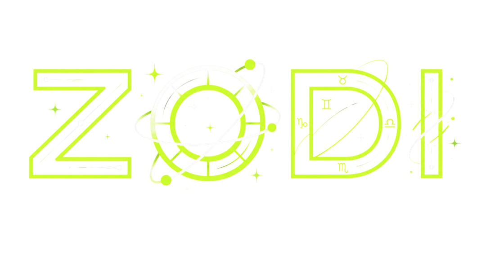

# ZODI — AI Astral Oracle (PWA)

ZODI is an installable **Progressive Web App** that delivers AI-powered
astrology: horoscope, tarot, natal charts and numerology — with a freemium
model, Google sign-in and offline support.

<!-- 📸 Tip: add a screenshot here →  -->

## ✨ Features
- AI-generated readings (horoscope, tarot, natal chart, numerology)
- Installable PWA with offline fallback and service worker
- Firebase Google authentication
- PHP API bridge for AI requests
- Multilingual support

## 🛠️ Tech stack
`PWA` · `HTML / CSS / JS` · `PHP (API bridge)` · `Firebase Auth` · `Service Worker`

## 🚀 Run locally
```bash
python -m http.server 4173 --bind 127.0.0.1
# open http://127.0.0.1:4173/
```
> For local UX review, `zodi-google-bridge.js` creates a local Google-style
> review profile. In production it uses Firebase Google sign-in.

## 📦 Production deploy
Upload the public files (`index.html`, `api.php`, `manifest.webmanifest`,
assets…) to the Hostinger public root. See `SECURITY.md` for details.

## 🔗 Links
[Case study](https://www.rodrigonegrete.es/zodi/) · [Portfolio](https://www.rodrigonegrete.es)

## 👤 Author
**Rodrigo Negrete** — AI Product Designer & Automation Architect
[LinkedIn](https://linkedin.com/in/rodrigonegretearos)
